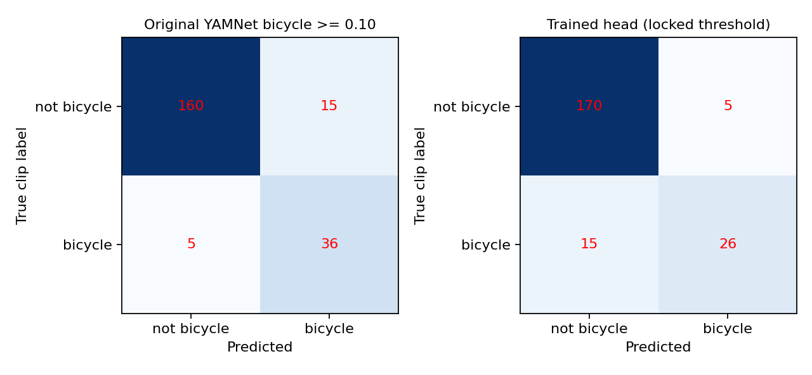

# 自行车铃专用分类器：真实训练与独立测试报告

实验：`bicycle-bell-transfer-20261102-v1`，2026-11-02。**真实模型已生成，独立测试已完成；提高召回、降低误报、缩短检测延迟的综合优化目标未达成。不得用本实验替换正式版模型。**

基线：V1.6.15，提交 `3a3e96b16bb78fa4d5ed006b44c18701e414fb40`。实验源代码固定在 `12a5ddc3be52903f8ce51e28f72b03af05f263bf`。所有改动仅在独立研究分支；没有修改正式页面、警告规则、麦克风流程或原始 `yamnet.tflite`，没有合并 PR。

## 1. 实际执行与可核验产物

本地环境对 Zenodo、Hugging Face 下载返回网络策略 403，未能在本地取得训练集。替代执行在本仓库 GitHub Actions 标准 CPU runner 上完成真实下载、特征提取、训练、参数选择和锁定测试：

- [数据预检成功](https://github.com/ky0o0/traffic-sound-guardian-v1/actions/runs/41401652277)：验证元数据及真实 WAV。
- [完整训练成功](https://github.com/ky0o0/traffic-sound-guardian-v1/actions/runs/41402862753)：实验流水线耗时 358.35 秒，不包括依赖安装；没有 GPU。
- [校验并永久保存训练产物](https://github.com/ky0o0/traffic-sound-guardian-v1/actions/runs/41403378952)：核对训练源提交及产物哈希，仅提交到研究分支，没有重新训练。
- 首次工作流配置因 job 环境变量引用 `runner.temp` 无效被拒绝，修正后才执行预检；没有将该失败当作训练结果。

产物位于 [results/20261102-v1](results/20261102-v1)：

| 文件 | 用途 |
|---|---|
| `bicycle_bell_head.tflite` | 实际训练的分类头，264,472 字节，输入 1×1024 浮点特征，输出 sigmoid 分数 |
| `bicycle_bell_head.keras` / `bicycle_bell_head_weights.npz` | 可继续研究的训练模型及折入标准化参数后的权重 |
| `yamnet_features.tflite` | 冻结特征提取器，仅增加可见输出，没有更新 YAMNet 权重 |
| `manifest.json` | 每段录音的作者、许可、来源、哈希、分组、分割 |
| `selection-locked-before-test.json` | 测试前锁定的模型、步长和阈值 |
| `metrics.json` / `confusion-matrices.png` | 测试指标和混淆矩阵 |
| `test-window-predictions.csv` / `test-errors.json` | 6,917 个测试窗口原始预测及全部 20 个错误 |
| `validation-candidates.json` / `training-history.json` | 12 种策略的验证结果及 6 个训练轨迹 |
| `reproduction.json` / `SHA256SUMS.json` | 环境、依赖版本、源提交和 20 个文件校验和 |

模型头必须配合本实验的特征提取和反量化接口使用，不是网站原模型的直接替换文件。原始音频及特征缓存没有提交到 GitHub。`infer.py` 可对真实 WAV 运行已训练模型。

## 2. 数据来源、许可与隔离

来源为 [FSD50K 官方发布](https://zenodo.org/records/4060432)，[论文](https://doi.org/10.1109/TASLP.2021.3133208)，实际通过 `Fhrozen/FSD50k` 镜像固定版本 `ccf1acaff12f3f4a4c10052dddafbb6d22152c9b` 下载。只采用逐录音许可为 CC0 或 CC BY、且能确认上传者的记录。935 段中 CC0 509 段、CC BY 426 段，署名信息保留在 manifest；不得因为镜像公开就忽略逐录音许可。

正例是人工 `Bicycle_bell` 标签录音，119 段；负例 816 段，包括门铃、Chime、Ding、Beep、其他铃声、音乐、环境声。门铃 100、Chime 100、Ding 28、Beep 88、其他铃 100、音乐 150、环境声 250。未用合成数据补足较少的类别。下载失败记录为空。

原始 dev/eval 汇总后重新做**自定义分组分割**，不能称作官方 FSD50K benchmark。上传者、原文件 SHA-256、响度归一后 PCM 哈希建立传递合并分组；同组只能出现在一个分割中。固定种子的外层五折、内层四折各取首折作为测试、验证；没有根据指标重新挑选分割。

| 分割 | 录音 | 正例 | 负例 | 独立组 | 正例上传者 |
|---|---:|---:|---:|---:|---:|
| 训练 | 544 | 54 | 490 | 419 | 32 |
| 验证 | 175 | 24 | 151 | 133 | 6 |
| 测试 | 216 | 41 | 175 | 142 | 12 |

缩放参数只拟合训练数据；一段录音的全部窗口继承同一分割。产物回读后再次检查上传者、组、文件哈希、PCM 哈希均无跨集合交叉。

限制：验证集 24 段正例中 19 段来自 `newagesoup`；测试正例中 `HBSA` 和 `geraldfiebig` 各 10 段。片段数量不等于独立声源数量，分组并不能消除来源分布差异。哈希不能排除跨上传者重新录制或混音。FSD50K 是片段级弱标签，未标自行车铃不保证录音实际不含自行车铃；没有完成逐段独立听审。也无法认证预训练 YAMNet 上游训练数据与这些录音完全无交叉。因此这里的“独立”严格指本次分类头训练／验证／测试隔离。

## 3. 实际训练与优化过程

冻结仓库量化 YAMNet，提取 `tower0/network/layer28/reduce_mean`（tensor 115）的 1024 维特征。量化 scale `0.022328350692987442`，zero-point `-128`；分类头使用反量化后的特征。原始 YAMNet SHA-256：`4d8b4a53282dc83ef04e3e7dbc4fbc98082e34e44ed798e16c3a0cdd4c584faf`。

实际处理 30,412 个真实录音窗口。窗口为 0.975 秒，使用与网站数值对照过的重采样；特征提取步长 240ms。只对不足一窗口的短录音补尾部零；长录音不完整尾窗不参与两方比较。采用以录音为 bag、窗口概率最大池化的多实例学习，避免把弱标签机械当成每一个窗口的真值。

预先固定 6 个分类头，比较 240ms 和 480ms 步长，共 12 种验证策略。线性头使用 L2 0.0001/0.001/0.01；MLP 使用 32 或 64 隐单元。最多 160 epoch，每 4 epoch 检查验证集，连续 6 次无改善早停。所有候选都在 28–56 epoch 早停，完成预先定义搜索后没有继续刷同一测试集。

下表为验证集结果，每个候选列出两种步长中的较优策略；完整两步长结果在 JSON 中。

| 分类头 | 实际训练 epoch | 步长 | Precision | Recall | FPR |
|---|---:|---:|---:|---:|---:|
| linear L2=.0001 | 28 | 240ms | 90.00% | 75.00% | 1.32% |
| linear L2=.001 | 56 | 240ms | 92.86% | 54.17% | 0.66% |
| linear L2=.01 | 28 | 240ms | 90.00% | 75.00% | 1.32% |
| MLP32 L2=.001 | 32 | 240ms | 92.86% | 54.17% | 0.66% |
| **MLP64 L2=.001** | **32** | **240ms** | **90.91%** | **83.33%** | **1.32%** |
| MLP32 L2=.01 | 28 | 480ms | 92.31% | 50.00% | 0.66% |

仅在验证集上选阈值，先要求 Precision≥90%、FPR≤2%，再最大化 Recall。最终阈值 `0.7501617074012756`。选择写入磁盘后才生成一次锁定测试报告。这里的搜索已完成，并不代表计算硬件彻底耗尽或所有模型方案已穷举；没有充分证据切换到其他骨干模型。

## 4. 锁定测试：优化目标未达成

比较使用相同的 216 段真实录音和相同窗口／预处理。原版固定 480ms 步长和默认阈值 0.10，实际调用原 `detection.js` 的 `chooseTarget`，不把所有 Bell 预测冒充自行车铃。原版“Bicycle 分数≥0.10”和“最终显示为 Bicycle bell”在本测试集上结果相同。

指标按录音计算：任何完整窗口达到阈值则整段检出；这是片段识别，不是逐事件检测。FPR 分母是 175 段负例，**不是每小时误报次数**。

| 策略 | TP | FP | FN | TN | Precision | Recall | F1 | FPR |
|---|---:|---:|---:|---:|---:|---:|---:|---:|
| V1.6.15 原版，480ms | 36 | 15 | 5 | 160 | 70.59% | **87.80%** | **78.26%** | 8.57% |
| 训练头，选定 240ms | 26 | 5 | 15 | 170 | **83.87%** | 63.41% | 72.22% | **2.86%** |
| 训练头，同为 480ms，沿用锁定阈值 | 24 | 4 | 17 | 171 | 85.71% | 58.54% | 69.57% | 2.29% |

主策略减少 10 次误报，同时增加 10 次漏报，Recall 下降 24.39 个百分点，F1 也下降。测试 Precision 和 FPR 均没有达到验证时设定的约束。测试 AP 为 0.8396，不能代替锁定工作点的失败结果。480ms 对照说明改善误报不能归因于增加推理频率；240ms 增加计算机会也没有超过原版召回。



完整 11 类原版警告的上下文统计为 TP40/FP66/FN1/TN109，但该规则本来就应该对喇叭、警笛等非自行车音报警，不能把它作为专用自行车分类器的公平误报比较。

## 5. 实际错误分析

训练头的 5 次误报：

| 类别／录音 ID | 标题 | 最大预测分数 |
|---|---|---:|
| Chime / 366677 | tic-tac-ping.wav | 0.9296 |
| Chime / 180522 | clock_8am_44_24.wav | 0.8301 |
| 其他铃 / 331674 | brass_bell_01_take9 | 0.9872 |
| 其他铃 / 221515 | service bell ring | 0.9974 |
| 音乐 / 325023 | TOY_GLOCK-21.wav | 0.9808 |

测试负例分层：Beep 0/21、Chime 2/20、Ding 0/9、门铃 0/17、环境声 0/52、音乐 1/33、其他铃 2/23（误报／录音）。零误报的小样本层不代表真实环境零误报。

15 个自行车铃漏报的 ID：90649、232963、323130、152953、78968、189764、158517、323127、189755、158503、189765、323126、158502、158519、323125。分数从 0.0065 到 0.7193，既有接近阈值的漏报，也有非常低分的漏报；仅放宽阈值不能证明能同时控制误报。标题、作者、源音频链接、许可和完整分数见 `test-errors.json`。

这些现象支持“仍混淆部分金属敲击／铃音，且对部分新来源自行车铃泛化不足”的后续研究方向；没有独立听审和事件标注，不能断言每段错误的声学原因。测试集已被打开，下一轮若根据这些错误修改模型，必须另备未使用的上传者／录音级最终测试集，不能继续把本集合当作未见过的数据。

## 6. 性能与延迟：实测范围

训练 runner：Linux x86_64 Azure、Python 3.12.15、TensorFlow CPU 2.20.0、NumPy 2.2.6，完整依赖见 `reproduction.json`。没有测试浏览器、iPad Safari、手机 CPU 或实际麦克风通路。

| 实测操作 | 样本数 | 平均 | P95 |
|---|---:|---:|---:|
| 冻结特征提取器 CPU 推理 | 30,412 窗口 | 1.644ms | 1.710ms |
| 已导出分类头 CPU 推理 | 6,917 窗口 | 0.00890ms | 0.01068ms |

以上为 runner 上的 interpreter 调用耗时，不含录音积累、重采样、浏览器通信和绘制。原始模型仅做了 8 窗口数值一致性计时，不足以宣称端到端加速。特征提取器与原模型的 8 窗口分类分数最大误差为 0；训练模型与导出 TFLite 头在真实测试窗口上的最大误差为 `2.6822e-7`。

文件起点到首次阳性：原版检出的 36 段平均 1.815s、P95 3.255s；训练头检出的 26 段平均 2.175s、P95 5.715s。**两者覆盖的录音不同，且铃声未必从文件起点出现；这些数值不是事件起点响应延迟，不能用来声称延迟改善。** 没有精确起点标注，无法验证降低实际检测延迟。窗口仍需约 975ms 音频；240ms 步长约增加一倍推理机会，也增加相应计算负担。

## 7. 复核与复现

实际执行：

```sh
npm test
python -m unittest discover -s research/bicycle-bell -p test_experiment.py -v
python research/bicycle-bell/experiment.py --out bell-results --cache /tmp/bell-cache
python research/bicycle-bell/verify_results.py
python research/bicycle-bell/infer.py research/bicycle-bell/results/20261102-v1 /path/to/real.wav
```

- 网站原测试：199 通过，0 失败；研究数值／协议测试：5 通过，0 失败。重采样与实际 `resample.js` 数值对照误差小于 `2e-7`。
- 在产物回读后独立核对 20 个文件 SHA-256、935 段录音的四种隔离键；从 CSV 重算 216 段录音的全部 5 个策略混淆矩阵，并对 6,917 个窗口重新执行原版 `chooseTarget`，全部一致。命令和复核结果保存在 `verify_results.py`、`verification.json`。
- 本地额外用真实 ESC-50 喇叭 WAV 载入已保存的原模型、特征提取器和头，与 NPZ 权重计算核对。这只是模型加载及数值冒烟检查，不计入独立测试成绩。
- `verification.json` 记录额外核验；其生成在锁定测试之后，没有重新训练或选择阈值。

## 8. 结论与下一步

真实训练和可复核测试均已执行，但专用头没有优于原版的综合表现，不建议部署，不能宣称获得交通安全保护能力。保留草稿研究 PR，不合并。

下一步应先获取不同实体车铃、不同距离、街道噪声和手机录音的额外合法数据，按上传者／录制会话分组，人工标出事件起点；增加金属铃、服务铃、钟声和音阶敲击等难负例。分配新的未见最终测试集后，才能比较校准／多任务头、适量训练增广或其他骨干，以及测量事件级召回、每小时误报及端到端延迟。不能为了展示更高 Recall 而在当前已打开的测试集上反复下调阈值。
