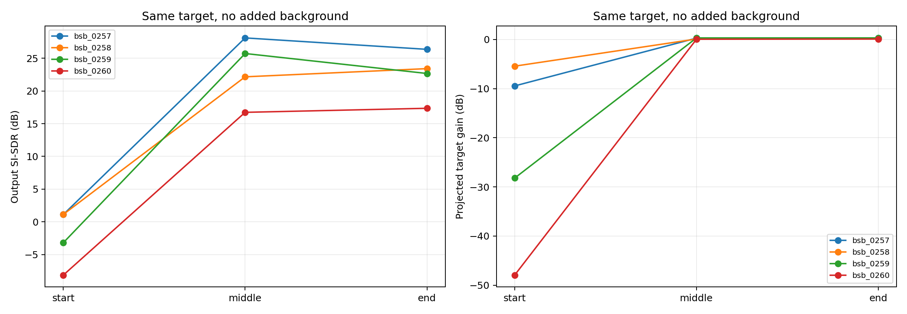
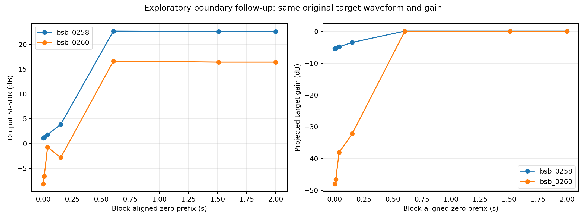
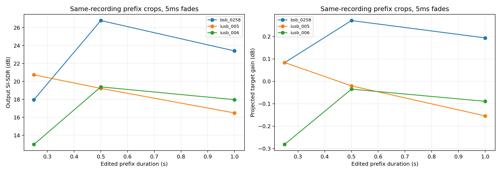
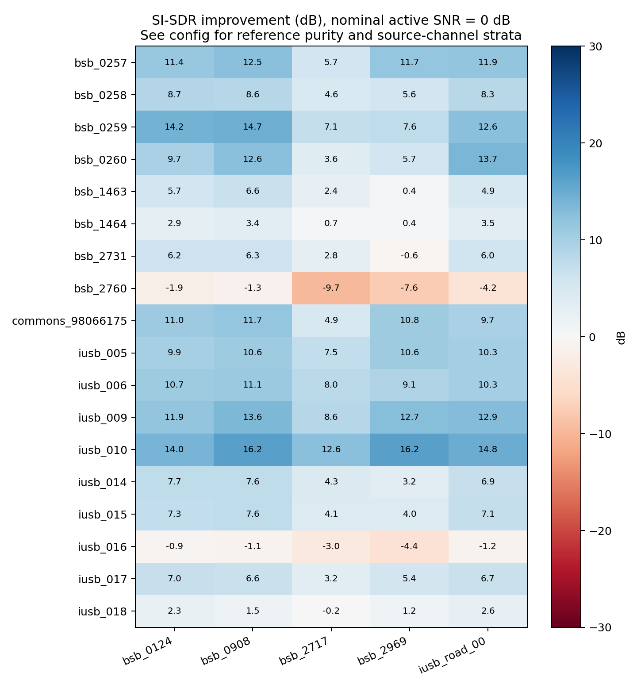

# Semantic Hearing 第二轮真实音频实验报告 — 2026-10-30

**已完成 238 个冻结条件、75 次独立复跑、42 个探索性追加对照，共 355 次成功模型推理。最重要的发现是启动边界效应：第一轮 0260 的严重失败可由处理上下文干预大幅改变，不能归咎于“短喇叭本身不可提取”。**

同一批第一轮原始混音，按模型块对齐前置约 1.509 秒静音、输出按预先指定偏移裁回原五秒后，0260 六条件平均 SI-SDRi 从 **−34.857dB 到 +7.061dB**；同长度尾部补零仍为 **−34.857dB**。原始目标、背景、增益、评分区间均保持一致。它证明启动边界/历史上下文处理是第一轮失败的重要可干预原因，但尚未唯一定位网络内部机制。

模型因而值得继续研究，下一步优先验证连续状态处理与真实双耳数据。复杂背景仍可明显削弱目标，当前证据不支持“已经稳定提取交通警告音”。

素材共 **23 个不同原始文件**（9 喇叭、9 警笛及场景、5 背景），不是 23 个已确认独立场次。真实双耳比较、每类 8 个已确认独立场次、干净立体声警笛充分样本仍未完成。

## 研究边界与第一轮基线

本轮从 PR #15 的最新研究提交 `90ccda5ed84b9c5f8d23add5802d9b84e716c698` 创建独立分支 `research/sh-round2-controlled-20261030`。已核查第一轮 Python、配置、来源清单、两次成功运行结果、初始失败记录、Actions、研究报告和复现说明；PR 无评论及审查意见。第一轮为 6 个原始文件、36 个条件，其中 0260 在 6 个受控混音中的平均 SI-SDRi 为 −34.857 dB，0258 为 −0.985 dB。第一轮警笛参考包含其他场景声音，不能解释为纯警笛分离分数。

仅测试官方 Semantic Hearing：不训练、不更改网络参数，不调用 YAMNet 或 PAWS；网站文件、main、PR #15 分支及原有结果均不修改，不部署、不合并。

## 待检验问题

- 0260 的失败能否在相同处理规则下复现？
- 完全相同的事件在开头、中间、结尾，改变的是波形恢复、幅度保留，还是二者？
- 同一录音裁剪成不同长度或重复拼接，是否呈现一致的时长效应？这些编辑均不计为新录音。
- 在固定活跃区间 SNR 下，雨、道路、人群、风中的结果如何变化？
- 相对孤立的真实警笛录音是否比第一轮场景更适合作参考？单声道适配诊断能说明到什么程度？
- 交换或合并声道是否改变同一录音的输出？它不能直接验证真实双耳录音的优势。

配置 `config.json` 在观察本轮模型输出前冻结（提交 `f2d18e1`）。这是探索性受控实验，不是正式预注册或随机抽样基准；没有根据输出筛选“成功素材”。

## 数据与许可

三个来源：BigSoundBank（CC0）、Zenodo Isolated Urban Sound Database（IUSB，CC BY 4.0）、Wikimedia Commons 的 CC0 汽车喇叭（原作者 15HPanska_Ruttner_Jan，Freesound 461679）。IUSB 作者为 Jean-Rémy Gloaguen、Mathieu Lagrange、Arnaud Can、Jean-François Petiot，DOI 10.5281/zenodo.1213793；按 CC BY 4.0 标明归属、许可和修改。处理包含裁剪、重采样、补零、混音及模型提取。

所有接受文件均记录原始下载网址/归档成员、原作者或语料库作者、许可、SHA-256、格式、声道、时长和相关性。IUSB 使用公开 ZIP 的普通 HTTP 字节范围读取，未绕过访问限制；逐成员哈希在后续运行中严格核对。发布者给出的完整 ZIP MD5 仅记录，未宣称已下载并验证整个 2.3GB ZIP。

23 个原始文件：9 个喇叭、9 个警笛/警笛场景、5 个背景。**原文件不同不证明录制场次独立**：四个 DenisChardonnet 喇叭是否同场次未知；IUSB 没有获得可确认每个原录制场次的映射；两段救护车警笛可能同场次。没有把 238 个条件称为 238 个独立声音，也没有宣称满足每类 8 个已确认独立场次。

21 个原文件具有两个有差异的录制声道；这只支持普通立体声探索。1463/1464 原始单声道，为测试相对孤立警笛而明确适配成双通道；单列 `explicit_dual_mono_diagnostic`，绝不计为真实立体声/双耳录音。没有获得可比较的真实耳部双耳数据，因此实验 E 的“真实双耳 vs 普通立体声”未完成。

来源质量的三层限制：

1. BigSoundBank 的四个汽车喇叭和 Commons 喇叭由发布者标为目标录音，但没有独立人类逐帧纯度标注。
2. IUSB 的 `event/carHorn*.wav`、`event/siren*.wav` 是语料库事件录音；事件标签不证明没有底噪、车声或其他共现声音。参考型指标衡量“已知添加的整条录音成分”，不自动等于纯语义源质量。
3. 1463/1464 发布者明确描述为室外录音、发动机未开启，比第一轮场景更有参考价值，但仍不能当作消声室无噪真值；2731/2760 明确仍为混杂场景，分开报告。

未进行专家盲听、事件级人类标注或主观评分。试听归档供后续审查，不能替代本轮缺少的纯度标注。

其他来源调查：Freesound 具体原录音页面要求登录下载，没有账号凭据；没有绕过登录。Wikimedia 后续出现 HTTP 429，停止该来源后续下载；保存成功文件和失败记录。Figshare LSSiren 为 CC0，但以大量道路警笛场景为主，两个 ZIP 各约 1GB，未在本轮优先下载，避免把更多场景切片作为独立干净警笛。ESC-50/FSD50K 属于 SH 所用语料，未将其随意引入后冒充独立外部测试。即便本轮换了提供网站，IUSB/Commons 与 FSD50K/ESC-50 的底层 Freesound 来源仍可能重叠；因缺少权重所用原始文件级训练映射，训练独立性未确认。

## 模型、环境与复现

官方源码固定在 `07e9786c7a741f0a7c722dcde66a2679ca068c50`；官方 `39.pt` SHA-256 为 `f0328655691378a65516ec08add170bcf474ba41bb2d475af7a7c63bf2478a21`。每次反序列化前校验，严格加载全部参数。原适配器 `../extract.py` 保持不变，新包装 `infer.py` 只固定随机种子和线程并补充真实声道来源字段。原始 20 类顺序保持不变，car_horn 为第 5 项、siren 为第 17 项。未调用的空间评估函数沿用第一轮的 fail-closed 占位处理，不参与网络 forward。

Python 3.10.22、torch 1.13.1+cpu、torchaudio 0.13.1+cpu、numpy 1.26.4、scipy 1.14.1、soundfile 0.13.1、torchmetrics 0.10.0、setuptools 69.5.1；完整依赖在 `dependency-lock.txt`，每次运行另存 pip freeze、CPU、源码哈希。固定 seed=20261030，CPU 两线程，推理均为离线五秒窗口。forward 耗时与含导入/加载/I/O 的墙钟时间分别记录，不解释为手机、流式、蓝牙或整机延迟。

本地云环境禁止官方权重和音频站点的网络下载，因此实际神经推理在两台新的 Actions 虚拟机完成；它们复用经哈希验证的冻结素材，分别重新下载并校验权重、重新构建依赖和生成输入。另一个新验证作业下载输出 artifacts 后重新计算指标和核对 WAV。未声称本地也完成整轮模型推理。

## 实验设计

全部输入为 44.1kHz、五秒、两通道；48kHz 采用与第一轮相同的 `resample_poly`，左右同参数。源音频先保留原始完整文件，再按固定偏移裁剪。没有用模型分数挑选最优片段。

| 实验族 | 条件数 | 控制及解释 |
|---|---:|---|
| 多背景 | 90 | 18 个目标文件 × 5 个背景；中间放置；活跃 SNR=0dB |
| SNR | 24 | 6 个指定目标 × 2 背景 × −5/+5dB；与上表 0dB 条件形成对应 |
| 位置 | 36 | 4 个相同喇叭 × 无添加噪声/雨/道路 × 开头/中间/结尾；每组三个位置共用目标增益、背景波形及增益、整体防削波增益 |
| 时长 | 27 | 3 个源录音 × 0.25/0.5/1秒前缀 × 无噪/雨/道路；5ms 边缘渐变；保留同一原录音基准幅度 |
| 重复 | 9 | 0260 拼接 2/4/8 次 × 无噪/雨/道路；明确为人工编辑并有接缝，不是自然长鸣笛 |
| 声道消融 | 18 | 3 个源 × 原声道/交换全部声道/左右平均后复制 × 无噪/雨；是处理对照，不是录制方式实验 |
| 电平 | 12 | 0258/0260 × 原增益的 0.1/0.316/1 倍 × 无噪/雨；保持设定 SNR |
| 第一轮复现 | 12 | 0258/0260 × 原来的两段雨声 × −5/0/+5dB 全片段 SNR；恢复第一轮位置、原始电平和峰值归一化规则 |
| 仅背景 | 10 | 5 个背景分别请求 car_horn 和 siren；无纯目标参考，不计算分离指标或误报率 |

总计 238 个条件。关键复跑 75 个条件覆盖第一轮 12 例、0258/0260 的 18 个位置条件、9 个警笛文件的 45 个多背景条件；复跑不增加原文件数。

主要混音的事件原录音峰值按同一源基准设为 0.25，背景增益依据中间位置的活跃 SNR 计算；如果需要，所有成分共同缩放至峰值不超过 0.8。位置组三个条件使用同一缩放。将目标移动到固定噪声的不同时间，会改变该时刻局部噪声能量；因此另记录各位置实测活跃 SNR，并用无添加噪声位置组提供更严格的对照。

活跃掩码是 20ms 帧 RMS 在最大帧 RMS 以下 35dB 以内，并向两边扩展一帧的**能量代理**，不是人类语义事件边界。同时保存活跃样本数、全窗口 SNR 和活跃 SNR；不将静音稀释后的 SNR 冒充短声事件实际 SNR。

## 指标与解释

沿用第一轮：左右分别去均值和投影计算 SI-SDR，再平均两个 dB 分数；SI-SDRi=输出−输入，不搜索有利时延，不按指标挑选裁剪。目标原录音为已知混音分量，包含其固有底噪。无添加背景的输入等于参考，因此不发布数值巨大的“改善值”；恰好全零输出的 SI-SDR 记为未定义，而不把数值截断产生的 0dB 当作真实得分。

另记录：

- 输出 SNR：10log10(||s||² / ||y−s||²)，保留增益影响，表示录音成分重建误差。
- 目标投影增益：α=<y,s>/<s,s>，每声道去均值后计算；给出带符号 α 和 20log10|α|。输出与参考能量比还包含残留噪声，不能代替目标幅度。
- 投影残差抑制：10log10(||n||² / ||y−αs||²)。残差同时包括未投影的目标失真和背景残留，不能称为纯背景抑制。
- 活跃段输出 SNR、SI-SDR 和能量保留，以及非活跃段输出能量占比。
- 每次实际 forward 和进程墙钟时间。

对于原参考含共现声的情况，上述分数仅为录音成分保真度。不同参考纯度、单声道适配和立体声不混成一个“准确率”。仅背景输出的能量不能证明模型幻觉警笛，也不能证明没有误报；没有人工事件标注，不报告误报率。

24 项自动测试（第一轮 16 项 + 新增 8 项），包括解析正交信号、与 torchmetrics 交叉核对、增益衰减、活跃 SNR 对比、静音无定义、位置波形/背景/增益一致性、格式和叠加关系。独立验证作业还对实际音频逐文件复算指标，不能用测试通过替代提取效果。

## 实际纳入的原始文件清单

完整 URL、SHA-256、归档成员和每个文件的声道相关性见 `config.json`；下表时长是原文件时长，非推理输入长度。IUSB 编号保留审计顺序，对应成员路径可直接复核。

| ID | 原文件/角色 | 原始格式 | 原时长 | 参考/通道说明 |
|---|---|---|---:|---|
| bsb_0257 | [Recent car horn #1](https://bigsoundbank.com/recent-car-horn-1-s0257.html) | 44100 Hz / PCM_16 / 2声道 | 0.482s | isolated_recording_with_unknown_noise_floor |
| bsb_0258 | [Recent Car Horn #2](https://bigsoundbank.com/recent-car-horn-2-s0258.html) | 44100 Hz / PCM_16 / 2声道 | 1.607s | isolated_recording_with_unknown_noise_floor |
| bsb_0259 | [Recent car horn #3](https://bigsoundbank.com/recent-car-horn-3-s0259.html) | 44100 Hz / PCM_16 / 2声道 | 0.425s | isolated_recording_with_unknown_noise_floor |
| bsb_0260 | [Car horn #4](https://bigsoundbank.com/car-horn-4-s0260.html) | 44100 Hz / PCM_16 / 2声道 | 0.494s | isolated_recording_with_unknown_noise_floor |
| iusb_005 | [carHorn06.wav](https://zenodo.org/records/1213793) | 44100 Hz / PCM_16 / 2声道 | 2.628s | unreviewed_corpus_event_recording |
| iusb_006 | [carHorn07.wav](https://zenodo.org/records/1213793) | 44100 Hz / PCM_16 / 2声道 | 2.482s | unreviewed_corpus_event_recording |
| iusb_009 | [carHorn10.wav](https://zenodo.org/records/1213793) | 44100 Hz / PCM_16 / 2声道 | 0.916s | unreviewed_corpus_event_recording |
| iusb_010 | [carHorn11.wav](https://zenodo.org/records/1213793) | 44100 Hz / PCM_16 / 2声道 | 0.919s | unreviewed_corpus_event_recording |
| commons_98066175 | [File:Car Horn.wav](https://commons.wikimedia.org/wiki/File:Car_Horn.wav) | 48000 Hz / PCM_24 / 2声道 | 3.514s | isolated_recording_with_unknown_noise_floor |
| iusb_014 | [siren01.wav](https://zenodo.org/records/1213793) | 44100 Hz / PCM_16 / 2声道 | 47.508s | unreviewed_corpus_event_recording |
| iusb_015 | [siren02.wav](https://zenodo.org/records/1213793) | 44100 Hz / PCM_16 / 2声道 | 48.416s | unreviewed_corpus_event_recording |
| iusb_016 | [siren03.wav](https://zenodo.org/records/1213793) | 44100 Hz / PCM_16 / 2声道 | 61.091s | unreviewed_corpus_event_recording |
| iusb_017 | [siren04.wav](https://zenodo.org/records/1213793) | 44100 Hz / PCM_16 / 2声道 | 36.269s | unreviewed_corpus_event_recording |
| iusb_018 | [siren05.wav](https://zenodo.org/records/1213793) | 44100 Hz / PCM_16 / 2声道 | 16.451s | unreviewed_corpus_event_recording |
| bsb_1463 | [Ambulance, 3 Ton Siren](https://bigsoundbank.com/ambulance-siren-1-s1463.html) | 48000 Hz / PCM_24 / 1声道 | 20.089s | publisher_no_engine_mono_recording |
| bsb_1464 | [2 Ton Siren](https://bigsoundbank.com/ambulance-siren-2-s1464.html) | 48000 Hz / PCM_24 / 1声道 | 8.105s | publisher_no_engine_mono_recording |
| bsb_2731 | [Vehicle Siren](https://bigsoundbank.com/vehicle-siren-s2731.html) | 48000 Hz / PCM_24 / 2声道 | 97.037s | contaminated_recorded_scene |
| bsb_2760 | [Gendarmerie motorcycle crossing](https://bigsoundbank.com/gendarmerie-motorcycle-crossing-s2760.html) | 48000 Hz / PCM_24 / 2声道 | 19.706s | contaminated_recorded_scene |
| bsb_0124 | [Rain and Thunder #1](https://bigsoundbank.com/rain-and-storm-s0124.html) | 44100 Hz / PCM_16 / 2声道 | 42.771s | rain |
| bsb_2717 | [Rain and Thunder #3](https://bigsoundbank.com/storm-and-rain-3-s2717.html) | 48000 Hz / PCM_24 / 2声道 | 40.272s | rain |
| bsb_0908 | [Wind in Tall Grass](https://bigsoundbank.com/wind-in-tall-grass-s0908.html) | 48000 Hz / PCM_16 / 2声道 | 85.107s | wind_vegetation |
| bsb_2969 | [Outside Talks #2](https://bigsoundbank.com/outside-talks-2-s2969.html) | 48000 Hz / PCM_24 / 2声道 | 134.257s | crowd_speech |
| iusb_road_00 | [traffic_bg01.wav](https://zenodo.org/records/1213793) | 44100 Hz / PCM_16 / 2声道 | 48.201s | traffic |

## 实测结果：第一轮复现与事件位置

第一轮 12 个喇叭混音均数值复现；SI-SDRi 最大绝对差仅 **0.00000363 dB**。0258 的六条件均值仍为 −0.985 dB，0260 仍为 −34.857 dB。证明旧现象可复现，不是更换机器后偶然消失。

更严格的无添加噪声位置对照如下：每行同一个原始声音、相同电平，只移动事件；表内为输出 SI-SDR / 投影增益，单位 dB。无背景时不计算 SI-SDRi。

| 来源（原始时长） | 开头 | 中间 | 接近结尾 |
|---|---:|---:|---:|
| bsb_0257（0.482s） | 1.109 / -9.446 | 28.108 / +0.283 | 26.361 / +0.276 |
| bsb_0258（1.607s） | 1.123 / -5.425 | 22.161 / +0.104 | 23.413 / +0.122 |
| bsb_0259（0.425s） | -3.199 / -28.203 | 25.723 / +0.325 | 22.671 / +0.325 |
| bsb_0260（0.494s） | -8.149 / -47.951 | 16.733 / +0.055 | 17.352 / +0.101 |

0260 在开头几乎被抑制，移到中间后输出 SI-SDR 为 16.733dB、投影增益约 +0.055dB；原始持续时间仍为 0.494秒。0.425秒的 0259 和 0.482秒的 0257 同样能在中间条件保留。1.607秒的 0258 在开头也明显变差。这些干预直接支持**窗口起始位置/处理状态是重要因素**，反驳“0260 因为短，所以模型无法提取”的单因解释。

原位置实验的偏移不是全部按模型块对齐，因此它单独不能区分初始化上下文、块内相位等细节。下述追加实验进一步检验。

## 追加实验：按处理块对齐的启动边界对照

这是观察主实验位置效应后设计的**探索性追加实验**，不冒充原先冻结协议。42 个条件均实际执行并保留完整模型输入、模型输出、固定裁剪输出和原五秒成分。官方神经网络与权重保持不变。

官方配置 L=32、decoder chunk=13，输入块为 416 个采样。前置长度取 1/4/16/64/160/212 个块（约 0.0094/0.0377/0.1509/0.6037/1.5093/1.9998秒），避免原位置实验的块内相位变化。评分输出只按**已知插入长度**裁剪，不搜索最优时延。

第一轮 12 个喇叭混音各设置前置静音和同长度尾部补零；两种模型输入长度完全相同，原五秒输入样本逐点不变。另对四个 0dB 混音加入原背景末尾 1.509秒作为噪声前导，以及两段喇叭的无添加噪声长度扫描。

| 来源 | 原五秒：平均 SI-SDRi | 前置 1.509秒静音 | 尾部补零 1.509秒 | 前置后目标投影增益均值 |
|---|---:|---:|---:|---:|
| bsb_0258 | -0.985 | +6.708 | -0.985 | -1.003 |
| bsb_0260 | -34.857 | +7.061 | -34.857 | -1.807 |

0260 前置后的六条件 SI-SDRi 范围为 +3.022 至 +12.598dB；目标投影增益均值由约 −49.57dB 恢复至约 −1.81dB。尾部补零没有产生相同恢复，排除了“仅仅扩大总输入长度就改善”的解释。前置样本数又是 416 的整数倍，因此该结果也不能仅用改变块内相位解释。

0260 无添加噪声的前置长度扫描如下；表内为输出 SI-SDR / 目标投影增益，单位 dB。

| 前置静音 | 输出 SI-SDR / 投影增益 |
|---|---:|
| 0 秒（原始起点） | -8.149 / -47.951 |
| 0.009433 秒 | -6.615 / -46.571 |
| 0.037732 秒 | -0.745 / -38.078 |
| 0.150930 秒 | -2.860 / -32.178 |
| 0.603719 秒 | 16.605 / +0.092 |
| 1.509297 秒 | 16.411 / +0.082 |
| 1.999819 秒 | 16.411 / +0.082 |

约 0.604秒及更长前置在这些无噪条件已恢复目标；1.509秒与1.9998秒结果基本一致。这不是一般性推荐的最短预热时间，因为只扫描了两条关联喇叭录音。

原第一轮 0260 + 雨声0124、全窗口 SNR=0dB 的同一混音：尾部补零 SI-SDRi=−31.100dB，前置静音=+8.756dB，前置原背景=+6.113dB。噪声前导也可恢复，但两段背景的均值恢复程度不同：0260 两个 0dB 条件的前导噪声均值 +3.300dB、目标增益约 −5.246dB，不能假定任何真实前导环境都会像静音一样理想。

**因果边界：**直接确认的是“在独立窗口边界前加入指定历史上下文，会改变同一原始混音的恢复”。官方代码每次独立 forward 初始化缓存为零；这种现象与初始状态/历史不足相符。尚未通过逐层状态干预唯一定位到某层缓存、偏置或注意力，也未完成有状态连续流式复跑，故不将某个内部机制写成已证明的唯一原因。

前置静音是本轮离线诊断手段，不是已经实现的实时耳机方案；不能把人工加入 1.509秒解释为测得的实际流式首帧延迟。下一步应直接验证官方状态缓存接口的连续运行和冷启动行为。

## 实测结果：持续时间与重复处理

同一录音前缀取 0.25/0.5/1秒，保留同一原录音基准增益并加 5ms 渐变。无添加噪声、中间位置的输出 SI-SDR 如下。它是编辑干预，不是增加原始录音样本。

| 原录音 | 0.25秒 | 0.5秒 | 1秒 |
|---|---:|---:|---:|
| bsb_0258 | 17.955 | 26.784 | 23.399 |
| iusb_005 | 20.731 | 19.221 | 16.482 |
| iusb_006 | 12.975 | 19.384 | 17.965 |

三段录音的 0.25秒编辑片段均有可观的波形保真度；没有一致的“越长越好”关系。它们在雨声中也有正 SI-SDRi（0.25秒分别 +12.152/+12.940/+13.838dB），但短片段全窗口参考含更多静音，数值不能直接替代活跃段质量；活跃段指标另在 CSV 中提供。

0260 在中间、无添加噪声时，原始一次为 16.733dB，拼接 2/4/8 次分别为 15.430/13.202/13.273dB。重复并未单调改善，而且拼接改变了声学内容及接缝，不能解释为自然持续时间效应。

## 实测结果：背景与电平

以下均为中间位置、相同 0260、实测活跃 SNR 约 0dB。不同背景已匹配活跃 SNR，表中目标投影增益仍相差很大。

| 背景 | SI-SDRi dB | 投影增益 dB | 输出重建 SNR dB |
|---|---:|---:|---:|
| rain（bsb_0124） | +9.650 | -7.497 | +2.190 |
| rain（bsb_2717） | +3.633 | -6.893 | -3.037 |
| wind_vegetation（bsb_0908） | +12.563 | -4.055 | +2.899 |
| crowd_speech（bsb_2969） | +5.672 | -13.500 | +1.252 |
| traffic（iusb_road_00） | +13.696 | -1.410 | +3.170 |

人群背景下虽有 +5.672dB SI-SDRi，投影增益却为 −13.500dB；第二段雨声中虽有 +3.633dB SI-SDRi，保留增益的重建 SNR 却为 −3.037dB。因此“改善为正”不是完整保留目标，更不是识别准确率。

这是**所选背景录音**的明显条件差异，没有足够每类独立录音估计背景类别总体效应或统计显著性。道路/人群等自然背景也没有人类逐帧确认目标类别完全缺席，背景若含同类事件会影响成分保真指标的语义解释。

0260 的低 SNR 雨声条件（活跃 −5dB）投影增益约 −16.251dB，进一步说明复杂背景中仍可能严重削弱目标。无噪中间条件的 0260 在峰值 0.025/0.079/0.25 的扫描里都能保留；0258 最低电平时输出 SI-SDR 从约 22dB 降至 5.993dB，说明电平敏感性可能依样本而异。这不能单独解释第一轮，因为旧处理的电平与窗口位置同时不同。

## 实测结果：各原文件与警笛参考边界

下表每行来自 5 个背景、活跃 SNR=0dB、中间位置；均值只在同一原文件内计算。IUSB 事件录音与原场景均是整条添加录音成分保真度，不能自动解释为纯警笛分离。

| 原文件 | 参考/通道层 | SI-SDRi 均值（范围）dB | 投影增益均值 dB | 正改善设置数 |
|---|---|---:|---:|---:|
| bsb_0257 | 发布者孤立录音/双声道 | +10.653（+5.717 至 +12.525） | -2.986 | 5/5 |
| bsb_0258 | 发布者孤立录音/双声道 | +7.168（+4.575 至 +8.719） | -2.523 | 5/5 |
| bsb_0259 | 发布者孤立录音/双声道 | +11.228（+7.052 至 +14.686） | -3.738 | 5/5 |
| bsb_0260 | 发布者孤立录音/双声道 | +9.043（+3.633 至 +13.696） | -6.671 | 5/5 |
| iusb_005 | IUSB未独立纯度标注/双声道 | +9.763（+7.457 至 +10.623） | -0.833 | 5/5 |
| iusb_006 | IUSB未独立纯度标注/双声道 | +9.834（+7.994 至 +11.071） | -0.795 | 5/5 |
| iusb_009 | IUSB未独立纯度标注/双声道 | +11.940（+8.586 至 +13.551） | -1.310 | 5/5 |
| iusb_010 | IUSB未独立纯度标注/双声道 | +14.754（+12.578 至 +16.217） | -0.484 | 5/5 |
| commons_98066175 | 发布者孤立录音/双声道 | +9.625（+4.908 至 +11.710） | -4.773 | 5/5 |
| iusb_014 | IUSB未独立纯度标注/双声道 | +5.923（+3.244 至 +7.651） | -1.267 | 5/5 |
| iusb_015 | IUSB未独立纯度标注/双声道 | +6.039（+3.989 至 +7.598） | -1.171 | 5/5 |
| iusb_016 | IUSB未独立纯度标注/双声道 | -2.116（-4.420 至 -0.908） | -10.036 | 0/5 |
| iusb_017 | IUSB未独立纯度标注/双声道 | +5.798（+3.194 至 +6.978） | -1.613 | 5/5 |
| iusb_018 | IUSB未独立纯度标注/双声道 | +1.499（-0.155 至 +2.577） | -5.053 | 4/5 |
| bsb_1463 | 无发动机录音/单声道适配诊断 | +3.995（+0.387 至 +6.565） | -5.511 | 5/5 |
| bsb_1464 | 无发动机录音/单声道适配诊断 | +2.164（+0.408 至 +3.505） | -3.616 | 5/5 |
| bsb_2731 | 混杂场景/双声道 | +4.134（-0.593 至 +6.308） | -3.116 | 4/5 |
| bsb_2760 | 混杂场景/双声道 | -4.943（-9.678 至 -1.324） | -20.013 | 0/5 |

两个较孤立的救护车警笛提供比第一轮更明确的录音参考：1463/1464 在这五个背景条件均有正改善，均值 +3.995/+2.164dB；但其目标增益均值为 −5.511/−3.616dB，1463 在人群下约 −9.888dB。它们是**原始单声道的双通道适配诊断**，不能据此宣布真实双耳纯警笛稳定提取。

IUSB siren01/02/04 的整录音成分有较好恢复，siren03 五个条件均退化，siren05 也不一致；原始 2760 场景仍较差。因为 IUSB 和自然场景没有干净警笛独立标注，不能把这些负分全部归因为警笛损伤，也不能把正分直接当作去掉了所有其他声音。

## 实测结果：声道处理与真正双耳实验

0260 在无添加噪声、中间位置的输出 SI-SDR：原声道 16.733dB，交换声道 16.649dB，左右平均复制 16.914dB。雨声条件左右平均后 SI-SDRi 从 9.650dB 到 13.348dB，投影增益从 −7.497dB 到 −4.164dB；但平均操作也改变参考波形和实际 SNR，不能当作只改变麦克风几何。

同一普通立体声录音只改变位置就能保留 0260，因此“不是真双耳”不能作为该失败的充分解释。没有完成可比较的真实双耳录音实验，无法测量双耳录制方式本身的优劣，也未计算空间线索保持指标。

## 来源独立性补查

对原始 WAV 的 RIFF INFO/bext/iXML、解码哈希和喇叭跨文件子片段相关性作了额外审计，见 [source_provenance_audit.json](evidence/source_provenance_audit.json)。四个 DenisChardonnet 喇叭的 BWF 日期字段都为 2007-03-30，两段救护车都是 2019-07-09；元数据不足以把它们认定为独立录制场次。IUSB 两个喇叭文件内部题名分别是 `120216_02`/`120218_01`，仍不能仅根据文件名确认录制日期。

九个喇叭固定片段的单声道子片段相关性最大约 0.382，没有在这个筛查中发现接近逐波形复制的证据；**这不是场次独立性的证明**。IUSB siren04 内部还保留了 Freesound 26711 和 Timbre 字段，原始条目的作者/许可链未独立复核；本轮依据 IUSB 发布的 CC BY 4.0 授权使用，并将该原始链问题保留为局限。Commons 喇叭的 Freesound 461679 源页可核实 CC0。检索没有获得 SH 实际训练文件级映射，不将没有搜索命中当作没有训练重叠的证据。

## 可复现性、时间及实际执行记录

- 主实验 238/238，独立关键复跑 75/75，追加 42/42；共 **355 次实际 forward**，没有神经推理失败。主实验 238 次中存在配对基线重复，按解码 PCM 计有 **216 个不同的五秒输入**；条件数不是原录音数。
- 主实验每个五秒输入 forward 中位数 **0.362秒**（0.323–0.418秒），进程墙钟中位数 1.746秒；脚本总时长 435.287秒。关键复跑 forward 中位数 0.488秒，脚本总时长 178.508秒。脚本总时长不包含预先安装依赖、Actions 素材缓存传输或上传 artifact。
- 两次主流程分别通过 24 项测试；独立验证作业下载 artifacts 后核查 **1,747 个 WAV** 的文件哈希、解码哈希、格式和有限性，并检查来源哈希、加和关系和重算指标。75 个关键输入逐点相同，输出最大绝对样本差 **8.64e−7**，SI-SDRi 最大差 **1.51e−5dB**。
- 追加实验由另一个新作业下载归档后核对 **252 个 WAV**，确认原五秒输入逐点保留；裁剪偏移按固定前置长度记录。精选 ZIP 已经由 git 取回本地，验证 ZIP CRC 和哈希，并独立重算 0260 两个关键前/后补零条件，SI-SDRi 与发布结果完全一致。
- 完整大 ZIP 在新的 Actions 作业下载并核验。当前本地云环境对文件服务下载域名亦拒绝连接，故没有宣称在本地读取并核对整个 1GB ZIP；本地核验边界仅为实际取回的精选包与指标。完整 ZIP 摘要使用 GitHub artifact 元数据所报 digest，WAV 内容核验见独立作业日志。

证据：[主实验核验](evidence/verification.json)、[追加核验](evidence/boundary/verification.json)、[本地关键复算](evidence/local_listening_verification.json)、[全部实际日志](evidence/logs/)。初始本地 uv 安装因索引优先策略未找到某固定版本，采用允许在两个受信任包索引择版本的解析后成功；没有在模型实验中途更换环境。权重及音频本地连接的 HTTP 403、Freesound 原文件登录要求、Commons 的 HTTP 429、无法确认的原始许可链和真实双耳素材不足均如实保留，未绕过访问限制。

## 对最终研究问题的回答

| 问题 | 由本轮数据支持的回答 |
|---|---|
| 第一轮差的主要原因？ | 对 0260 有直接证据的重要原因是事件紧贴独立窗口起点、缺少适当历史上下文；保持旧混音不变的前置/尾部对照将其平均 SI-SDRi 从约 −34.857 改至 +7.061dB。不能据此唯一定位网络内部机制，也不能把所有其他场景失败归为同一原因。 |
| SH 是否普遍不擅长短喇叭？ | 本轮不支持这种归因。0.425/0.482/0.494秒原录音在窗口中间均可恢复；0.25秒同源编辑也能保留。样本不足以估计短喇叭总体成功率。 |
| 时间位置是否影响？ | 是，受控干预显示很大影响；按块对齐、保持旧混音和评分区间的追加对照进一步支持边界/上下文效应。 |
| 背景噪声类型是否影响？ | 所选背景录音造成明显差异；0260 的目标增益约 −1.41dB（道路）至 −13.50dB（人群）。每类独立背景不足，不能称统计显著的类别总体结论。 |
| 更干净参考下能否提取警笛？ | 两个发布者标注无发动机的单声道录音，在主要五背景条件有正录音成分改善；仍有幅度损失，且不是立体声/双耳纯警笛验证。IUSB 各警笛事件差异明显，缺少独立纯度标注。 |
| 第二轮是否更可靠？ | 是，对第一轮失败的处理因素给出了受控、可复算的直接证据，并扩大了素材和背景；不等于已经解决干净参考、独立场次和真实双耳泛化。 |
| 原始 SH 值得继续吗？ | 值得。严重失败至少有一个很强的可干预流程因素，而相同权重能保留短声；不能因第一轮冷启动结果直接否定架构。 |
| 调处理、微调还是换架构？ | 优先验证连续状态缓存与冷启动处理、补齐真正双耳及可靠独立目标，再比较残余失败。当前不应直接将微调或更换架构当作解决已证明问题的首选。 |

## 下一阶段建议与未完成项

1. 保持同一官方权重，用缓存连续传递的流式接口复跑：固定块长、正确保存 encoder/decoder/output 状态，分别记录启动期和稳态。对第一声警告被抑制的问题单独建测试，不用整段均值掩盖。
2. 获取每类至少 8 个可确认独立录制场次的相对孤立真实目标，记录设备、日期、原作者及底噪，优先真正耳部双耳采集；为警笛建立可审查的干净参考和共现事件标注。当前 9+9 是文件数，场次独立性未确认；真实双耳实验 E 未完成。
3. 增加每类背景的独立录音，核实是否含同类警告音，按原录音分组做留出评价；先确认训练文件级重叠，再谈外部泛化。IUSB 部分来源链及所有素材与权重实际训练文件的关系仍未完全复核。
4. 把幅度保留与失真同时作为评价目标，补充盲听；标注 background-only 输出后才能评价明显伪警告及误报。目前没有人类盲听、误报率、空间线索保持、手机运行、端到端延迟或耳机实际帮助效果。
5. 如果稳态、正确空间输入和可靠参考下仍有系统性严重削弱，再安排按原始录音划分的微调研究和其他提取架构对照。本轮没有训练、没有改动神经参数，也没有集成任何新系统。

## 代码、报告与试听归档

- 研究分支：[research/sh-round2-controlled-20261030](https://github.com/ky0o0/traffic-sound-guardian-v1/tree/research/sh-round2-controlled-20261030)，从 PR #15 精确提交创建；[Draft PR #16](https://github.com/ky0o0/traffic-sound-guardian-v1/pull/16) 以 `research/sh-real-audio-recovery-20261030` 为目标，保持未合并。

- [复现命令和文件说明](README.md)、[冻结配置/来源清单](config.json)、[逐例主实验 CSV](evidence/full/analysis/results.csv)、[追加对照 CSV](evidence/boundary/results.csv)、[完整 artifact 元数据与 digest](evidence/artifact_registry.json)。

- [完整主实验 Actions](https://github.com/ky0o0/traffic-sound-guardian-v1/actions/runs/41011463180)，运行源码提交 `f2d18e19605b102d2cca5717bb22e3917258a676`；[追加对照 Actions](https://github.com/ky0o0/traffic-sound-guardian-v1/actions/runs/41012851317)，源码 `a2584bb2f0016340d4e40be658820f0ecba6392b`；[来源元数据审计](https://github.com/ky0o0/traffic-sound-guardian-v1/actions/runs/41012585969)。

- [永久精选试听 ZIP，9.13MB](evidence/listening-selection.zip)：5 个指定条件，每个有输入/输出/参考；[启动边界试听 ZIP，5.47MB](evidence/boundary/boundary-listening.zip)：同一 0260+雨声混音的前置/尾部补零提取，原五秒输入相同。都是原始幅度的 FLOAT WAV，无音量归一化；包内包含归属和许可。

| 完整可下载归档 | 大小 | 到期时间（日本时间） |
|---|---:|---|
| [完整 238 条件](https://github.com/ky0o0/traffic-sound-guardian-v1/actions/runs/41011463180/artifacts/12958162324) | 1091.92 MB | 2027-01-28 14:59:27 JST |
| [独立 75 条件](https://github.com/ky0o0/traffic-sound-guardian-v1/actions/runs/41011463180/artifacts/12957767960) | 866.75 MB | 2027-01-28 14:59:27 JST |
| [追加 42 条件](https://github.com/ky0o0/traffic-sound-guardian-v1/actions/runs/41012851317/artifacts/12958228578) | 235.08 MB | 2027-01-28 15:13:45 JST |

完整主实验归档包括 955 个 WAV，关键复跑归档包括 792 个 WAV（也含未执行条件的预制输入，其实际执行列表单独保存），追加归档包括 252 个 WAV。音频数量不代表独立样本数。永久分支保留完整指标、配置、来源哈希、格式清单、日志、图表和精选音频。完整 WAV artifacts 到期后需按来源重建，外部来源是否继续可用不受本项目控制；建议在到期前下载完整归档保存。

## 主要资料

- [第一轮 PR #15](https://github.com/ky0o0/traffic-sound-guardian-v1/pull/15) 与 [第一轮报告](../REAL_AUDIO_REPORT.md)。
- [官方 SemanticHearing 固定源码](https://github.com/vb000/SemanticHearing/tree/07e9786c7a741f0a7c722dcde66a2679ca068c50)，[论文](https://arxiv.org/abs/2311.00320)。
- [BigSoundBank CC0 许可](https://bigsoundbank.com/licenses.html)，[1463](https://bigsoundbank.com/ambulance-siren-1-s1463.html)、[1464](https://bigsoundbank.com/ambulance-siren-2-s1464.html) 的设备和单声道说明。
- [IUSB 数据及 CC BY 4.0 元数据](https://zenodo.org/records/1213793)，[原始录音拼接构建场景的研究摘要](https://acousticalsociety.org/wp-content/uploads/2018/02/Boston_Thursday.pdf)。本轮使用原始 event/background 成分文件，不使用已混合的 SimScene 场景当干净目标。
- [Commons 喇叭与原作者/许可](https://commons.wikimedia.org/wiki/File:Car_Horn.wav)，[原 Freesound 461679 条目](https://freesound.org/people/15HPanska_Ruttner_Jan/sounds/461679/)。
- [尺度不变分离指标定义与注意事项](https://arxiv.org/abs/1811.02508)。
