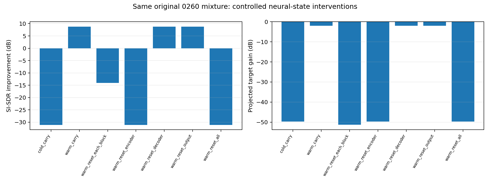
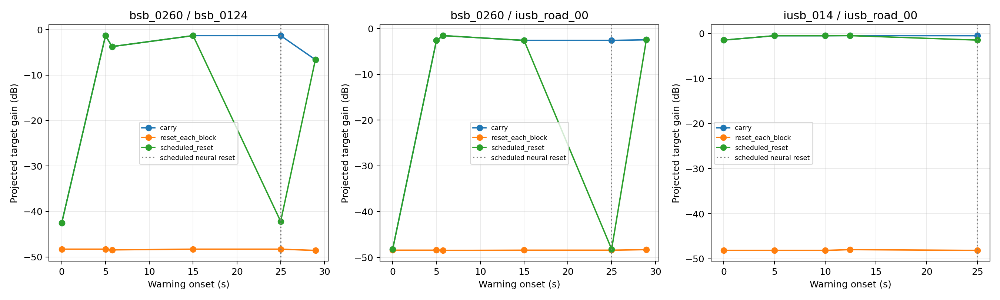
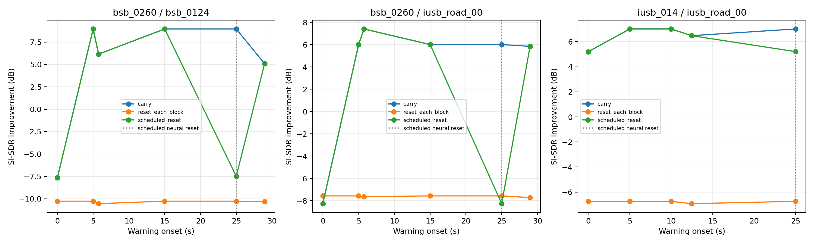
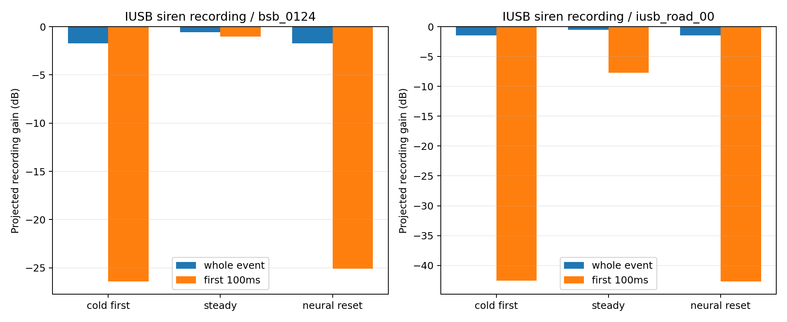
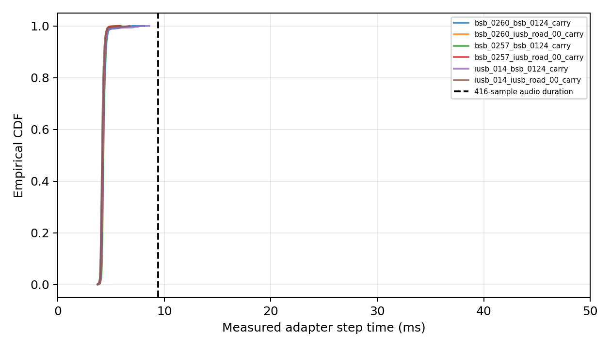

# Semantic Hearing 第三轮：连续处理、启动状态与实时可行性 — 2026-10-30

**已建立并验证官方39.pt的真正有状态逐块适配。正确保存状态可明显改善有真实背景历史的后续警告；冷启动即出现的第一声短喇叭仍会严重削弱，指定重置后也会再次退化。不能据此声称已实现稳定的实时耳机系统。**

同一第二轮关键0260混音：冷启动连续处理 SI-SDRi **−31.100dB**；静音历史后连续处理 **+8.756dB**；仅清零 encoder 缓存又回到 **−31.101dB**。本轮将重要状态进一步定位到encoder历史缓存，但没有唯一定位到具体层或某个偏置/归一化机制。

在 Intel Xeon 8370C、torch两线程上，正常连续策略RTF **0.453–0.467**；每416采样块前向中位耗时约 **4.09–4.22ms**，块音频时长9.433ms。约10.159ms的采样收集等待加计算/调度后，真实时钟文件回放中警告对应采样约 **15.169ms** 后计算完成。这个时间不含麦克风、DAC、手机或蓝牙链路，也不证明输出足够可听。

复用5个原始录音，零原始音频重下载；构造6段约30秒信号、34次事件插入。完成 **33个质量/性能运行＋4次整段门槛校验**；内部39.pt forward共 **65,850次**，其中65,840次是流式小块调用，10次是整段调用。这些不是65,850个独立实验或录音。详细单位和成功/失败边界见下文。

## 1. 研究范围、起点与前两轮证据

从 PR #16 最新研究提交 `97e51d7d51ac1128ff097753161fa538f2790b95` 创建 `research/sh-round3-stateful-20261030`。核查了第二轮代码、报告、配置、Actions、原始运行日志、355 条实际运行结果和核验文件；PR 没有评论或审查意见。没有改写第一、第二轮文件或结果，没有修改 main 或正式网站 V1.5.4，没有合并 PR，也没有网站、YAMNet、PAWS、训练或参数调整。

第一轮的 0260 六条件平均 SI-SDRi 为 −34.857dB；第二轮对相同混音前置约 1.509秒静音后为 +7.061dB，尾部补零没有恢复。因此本轮重点是连续状态、初始条件和时序，未重复大规模素材搜索或数百条件的背景网格。

## 2. 官方实现调查与新增适配功能

固定官方源码 `07e9786c7a741f0a7c722dcde66a2679ca068c50`，同一官方 `39.pt`，SHA-256：`f0328655691378a65516ec08add170bcf474ba41bb2d475af7a7c63bf2478a21`。加载前严格验证，并严格加载全部参数。推理为 eval/inference_mode；没有优化器或参数更新。沿用前两轮对未调用ITD/ILD函数的fail-closed导入隔离，若调用会报错，没有替换神经网络模块或验证空间指标。

官方 `src/training/dcc_tf_binaural.py` 提供 `Net.init_buffers()` 和带 `init_enc_buf`、`init_dec_buf`、`init_out_buf` 的 `Net.forward()`；显式传入状态时返回输出和更新后的三组状态。它不是完整的麦克风流式应用，但确实有可使用的状态接口。只按论文宣传推断“支持流式”不够，本轮通过原码、结构测试和预训练权重的整段/分块等价性来验证。

| 环节 | 固定配置与官方行为 | 本项目新增内容 |
|---|---|---|
| 输入卷积 | stride L=32，lookahead=True，kernel=96 | 保留前32个真实采样并等待后32个采样；流开始左侧补零，只有 EOF 才补结束所需零 |
| encoder | 10层膨胀因果卷积，逐层历史缓存总计2046个latent frame | 持续传递官方返回的 encoder 缓存；按实验计划清零以作消融 |
| decoder | 每组13帧、历史13帧，当前13帧内的注意力没有逐采样因果mask | 每次产生13个新latent帧，保持官方decoder分块边界，传递decoder缓存 |
| 输出卷积 | out_buf_len=4，保存4帧已掩蔽latent输出历史 | 传递out缓存，拼接连续输出并保留原始样本时间索引 |
| 主机音频流程 | 官方未提供本项目所需的完整采集、分包、时钟记录流程 | 新增FIFO、状态快照/恢复、重置计划、EOF、采样时间戳、逐块计时及文件节拍回放 |

新适配器每步处理 **416 个新采样（13×32，9.433107ms）**。模型输入包含输入卷积所需的64个边缘采样，总长480。它没有重算互相重叠的五秒窗口，只有卷积感受野所需的小范围原始采样衔接；内部历史由官方缓存传递。

`pad=True` 不能简单地用于每个相邻块，否则会在块边界反复插入虚假上下文。本适配器自行衔接PCM、显式传入状态并调用官方 `pad=False` 路径；没有修改官方神经网络。末尾不满一块时只计算实际所需的latent帧，保留官方decoder末块补齐规则，固定裁掉已知EOF补齐样本，不搜索最优时延。

**不是逐采样零未来上下文：**官方输入卷积需要少量右侧采样，decoder会联合处理当前13帧。对本适配器，首个416采样输出要等到第448个输入采样可用；名义最大块收集等待为 **10.158730ms**。过去缓存长度不是算法输出延迟；约1.5秒历史范围不能直接当作必须延迟播放1.5秒。输出样本索引与官方整段结果对齐，但这些样本的实际可计算时刻晚于其输入时间。

## 3. 素材复用、许可与独立性

没有重新下载任何原始音频，也没有下载第二轮1GB完整归档。直接复用仓库中两个已提交的小型FLOAT WAV ZIP（约9.13MB和5.47MB），先校验ZIP SHA-256，再与第二轮完整WAV清单核对每个使用的目标参考和关键混音的字节哈希。

5 个原始录音来源：汽车喇叭0257、0260（DenisChardonnet，BigSoundBank，CC0），雨声0124（Joseph SARDIN，BigSoundBank，CC0），IUSB siren01及traffic_bg01（IUSB语料作者，Zenodo 10.5281/zenodo.1213793，CC BY 4.0）。本轮只有3个目标原录音、2个背景原录音，重复警告和处理方法不增加独立来源。

完整[作者/许可和修改说明](ATTRIBUTION.md)另存。背景成分来自第二轮同步FLOAT混音减去已知参考成分：float64相减后保存为float32，含上轮浮点混音的舍入误差。它不是新取得的原始采集声轨。IUSB警笛使用第二轮五秒参考的前两秒，加5ms边缘渐变，明确为人工编辑；其参考仍是整个录音成分，未经独立纯度标注，不是经证明无底噪的纯警笛。来源许可及原录音链沿用第二轮记录，训练重叠和场次独立性未确认。

所有来源是普通双声道探索数据，没有确认真正耳部双耳采集。本轮不使用第二轮单声道1463适配数据，不声称完成真实双耳或空间线索验证。保存每个派生声轨的解码哈希、来源关系、许可和编辑说明；没有把不同处理当新录制场次。

## 4. 分阶段设计及控制变量

先在本地以未训练的**同一官方架构**执行8项接口测试；它们只验证适配语义，不作为声音提取效果。然后在新Actions环境使用官方39.pt，执行小规模预训练权重门槛：整段与正确分块输出等价、未来采样边界、第二轮关键混音数值复现，以及状态分量干预。只有该门槛实际成功后，才扩展长音频。

扩展作业校验门槛结果，还比对已验证适配器、模型加载器、输入构造程序和研究执行程序的SHA，避免验证一种程序却用另一种程序扩展。权重在首次合法获取后使用同哈希Actions缓存，后续作业复用并再次校验；没有把权重提交进Git或音频artifact。

### 4.1 关键原混音与状态分量干预

复用第一轮0260+雨声0124、全窗口SNR=0dB的完全相同五秒输入和同步录音参考。比较冷启动有状态处理、连续处理160个416采样块的静音历史后再处理原混音、每块清零，以及静音历史后只清零encoder/decoder/output/全部状态。清零点精确对齐模型块，保持实际输入卷积边缘一致，不改变神经参数、目标增益或原五秒评分区间。

每个状态分量消融都属于研究干预，不能根据某一条录音整事件分数变化很小，就删掉正常适配器的decoder或output缓存；正确适配器始终保存三组状态。

### 4.2 连续多事件、冷启动和指定重置

构造6段 **29.997279秒** 的连续信号：3个目标×2个背景。背景用第二轮五秒派生成分的前530个模型块周期拼接，周期4.999546秒；明确记录拼接边界，不把它当作未经编辑的半分钟现场录音。

喇叭每段放置6次同一事件；警笛每段5次，共34个事件插入。喇叭包含冷启动即出现、约5秒后、短间隔（约0.755秒）后、约15秒后、约25秒后、约29秒后；警笛采用不重叠的两秒事件并含较短/较长间隔。精确插入开始和结束采样、活跃能量掩码均保存。插入边界不是人类逐帧语义标注。

所有事件起点是416的整数倍。关键冷/稳态对照又保持背景周期相位一致，因此相同目标、目标电平、局部背景和块内位置**逐采样相同**；已在模型输出出现前冻结输入哈希并检查。额外短间隔等事件的背景相位可能不同，单独记录其实测活跃SNR，不把它们的差异全部解释为历史状态。

每段连续输入设置三种策略：

1. `carry`：三组官方状态始终正确保存和传递。
2. `reset_each_block`：每416新采样重置全部神经状态，是错误状态使用的消融对照，保留同样的真实PCM卷积边缘。
3. `scheduled_reset`：连续运行后，在第2650块（约24.997732秒）的警告前主动清零三组神经状态，保留该点真实原始采样边缘。重置前的全部输出必须与carry一致。

每段再执行一次官方整段forward用于数值参照；这六次是离线对照，不把它们称为流式处理。主要结论来自每个事件，而非整段平均。

### 4.3 时间与资源测量

输入传入包为32采样（0.725624ms），模型步仍为416采样。记录每块输入已到达采样、输出开始/结束采样、所需未来边界、前向耗时、含转换及状态处理的step耗时、EOF补零、实际重置点等。

- **forward耗时**：围绕官方模型调用测得的CPU墙钟时间，不含权重加载。
- **step耗时**：包含该步张量转换、所需状态处理、模型计算、输出转换；输入包复制等循环开销另包含在非节拍整段适配器墙钟RTF中。
- **音频块持续时间**：416/44100，约9.433ms。
- **算法收集等待**：由明确采样边界算出，不同于计算耗时。
- **排队估计**：用每步实测服务耗时、输入样本时钟，按串行服务 `start=max(input_ready, previous_finish)` 计算，是估计，不是物理设备测量。
- **真实时钟文件节拍回放**：先按节拍输入约2秒真实背景，再输入同一五秒0260混音；测对应警告样本到输出计算完成的墙钟时间、各输入包唤醒迟到和结束刷新时间。这不是麦克风输入、DAC播放或蓝牙延迟。
- **RTF**：分为forward总耗时/音频时长，和非节拍适配器循环墙钟/音频时长。节拍回放墙钟约等于音频时长由节拍本身决定，不能拿它证明模型吞吐量。
- **资源**：固定torch两线程，记录CPU型号、过程CPU时间、CPU占用率、RSS和进程生命周期峰值，以及明确的神经状态字节数。进程峰值包含框架、文件实验与评价，不能视为模型独占RAM。

这里的“警告对应输出可用”只表示输出采样已计算出来。它可能仍被严重削弱或失真，不等于已经检测到警告、警告可听或耳机已经播放。

## 5. 评价方法与复现边界

沿用第二轮固定对齐、左右分别去均值投影的SI-SDR、输入/输出SI-SDR及改善值、增益敏感重建SNR、带符号目标投影系数、投影增益dB、输出/参考能量以及活跃区间指标。没有选择最优输出延迟来提高指标。

每个事件以插入开始至结束后固定100ms为评分区间；事件不重叠。另提供开始100ms和其余事件部分的质量，避免较长警笛后段掩盖起始丢失。活跃掩码仍是20ms RMS相对峰值−35dB并扩展一帧的能量代理。所有指标反映已知添加录音成分的恢复，尤其IUSB参考内可能还有其他环境声。

输出WAV保留模型原始幅度，不单独归一化，不为试听裁掉弱输出。逐块模型输入可由保存的连续input.wav和trace中的原始采样区间/EOF补零精确重建；输出同样由连续output.wav和起止采样精确定位。没有为每个块另存大量重复的小WAV，也没有保存每块数MB的重复缓存，以控制资源；初始缓存、顺序、重置和固定模型足以复现内部状态演化。

独立验证已在另一个新环境下载本轮实际归档，复算事件指标，检查WAV/解码哈希、采样顺序与未来边界、重置前输出一致性，并只重跑一条30秒关键流。源文件不同、事件数、方法运行数及内部forward调用数分别报告，不把推理成功当提取准确率。

## 6. 预训练门槛与状态机制干预

正确carry的冷启动分块输出与整段输出最大绝对样本差为2.86e−7；静音历史条件为1.52e−6。两者同一评分区间的指标等价门槛均通过。改变第448采样以后的输入不改变前416个输出；改变当前块内后段输入，会使最前128个输出变化，最大约1.61e−4，实测支持“当前块内包含未来依赖”，不是逐采样严格零lookahead。

以下全部使用**第一轮原0260+雨声0124、全窗口SNR=0dB混音的相同五秒评分区间**。前置静音仅用于状态诊断；没有归一化输出或搜索有利对齐。表内缓存重置发生在静音历史结束、原混音开始的精确块边界。

| 方法/状态 | 输出 SI-SDR dB | SI-SDRi dB | 投影增益 dB | 重建 SNR dB |
|---|---:|---:|---:|---:|
| 冷启动＋正确carry | -31.099 | -31.100 | -49.702 | -0.071 |
| 静音历史＋正确carry | 8.757 | +8.756 | -2.032 | +8.960 |
| 静音历史＋每块重置全部 | -14.083 | -14.084 | -51.235 | -0.024 |
| 静音历史后仅重置encoder | -31.100 | -31.101 | -49.702 | -0.071 |
| 静音历史后仅重置decoder | 8.757 | +8.756 | -2.032 | +8.960 |
| 静音历史后仅重置output | 8.757 | +8.756 | -2.032 | +8.960 |
| 静音历史后重置全部 | -31.099 | -31.100 | -49.702 | -0.071 |

这是针对缓存的直接干预：相同输入、相同原始采样边缘、相同块相位和权重，只有指定神经状态不同。清零encoder即可重现该案例的冷启动严重削弱，支持encoder历史缓存是关键因素。单独清零decoder或output对本案例整事件分数影响很小，**不能据此断言它们可以从正确连续处理实现中删除**，也未验证把二者同时删除会怎样。

源码中encoder缓存存放多层历史激活，零输入运行所产生的历史不必等于简单全零缓存；多层偏置、归一化及其传播是待进一步分解的解释。本轮没有逐层替换激活或单独干预偏置，因此不宣称已经证明某一层/某一参数是唯一根因，也不将所有其他失败归为同一原因。

### 6.1 与第二轮原窗口、前置静音和尾部补零的直接对照

下表沿用完全相同的0260＋0124、SNR=0dB原五秒输入、参考和评分区间。第二轮三行直接引用已保存的[边界对照结果](../round2/evidence/boundary/results.json)，没有重复执行；本轮三行来自本轮预训练门槛，历史长度同为66,560采样（1.509297秒）。

| 来源及处理方式 | SI-SDRi dB | 目标投影增益 dB |
|---|---:|---:|
| 第二轮：原独立窗口 | -31.100 | -49.702 |
| 第二轮：前置静音，整段处理后裁回原评分区间 | +8.756 | -2.032 |
| 第二轮：尾部补零，仍评分原区间 | -31.100 | -49.702 |
| 本轮：冷启动有状态连续处理 | -31.100 | -49.702 |
| 本轮：先连续处理静音历史，再立即连续处理原混音 | +8.756 | -2.032 |
| 本轮：静音历史后只清零encoder，再处理原混音 | -31.101 | -49.702 |

因此，正确连续处理能够重现前置静音的数值改善；仅增加未来尾部没有同样效果，encoder历史干预进一步支持历史状态的作用。这里的静音历史仍需实际运行或预计算，不能当作零成本的现实启动方案。真实背景历史的文件节拍对照见第9节。

## 7. 连续多事件、冷启动与重置结果

每行比较的关键事件具有完全相同的目标和局部背景，均对齐模型块；相同背景相位事件的实际活跃SNR约0dB。下表每格为 **SI-SDRi / 目标投影增益（dB）**，使用“事件＋固定100ms尾部”的评分区间。该评分区间和混音电平与上一节原五秒条件不同，不能把两节的绝对分数直接合并。

| 原目标/背景 | 冷启动第一声 | 约5秒后的carry | 约25秒指定重置后的同声 |
|---|---:|---:|---:|
| bsb_0260 / bsb_0124 | -7.652 / -42.532 | +8.961 / -1.317 | -7.484 / -42.189 |
| bsb_0260 / iusb_road_00 | -8.257 / -48.189 | +6.007 / -2.573 | -8.268 / -48.197 |
| bsb_0257 / bsb_0124 | -6.283 / -28.186 | +4.464 / -1.194 | -6.411 / -28.355 |
| bsb_0257 / iusb_road_00 | -19.776 / -57.724 | +5.570 / -1.196 | -19.676 / -57.636 |
| iusb_014 / bsb_0124 | +5.356 / -1.724 | +7.695 / -0.585 | +5.362 / -1.719 |
| iusb_014 / iusb_road_00 | +5.205 / -1.468 | +7.017 / -0.498 | +5.210 / -1.466 |

正确carry在约25秒处的匹配事件与其约5秒事件数值一致；重置策略在指定点前的全部输出与carry**逐点完全相同**，指定点后才退化。0260雨声从约−42.53dB目标增益恢复到−1.32dB，重置后又降到−42.19dB；道路背景对应约−48.19/−2.57/−48.20dB。这不是因为后续换了一个更容易的声音。

每块重置使各喇叭及警笛录音成分持续被明显削弱，投影增益普遍在约−48至−50dB。它是状态错误使用的消融，不是可用的官方连续处理方式。

两个喇叭在约29秒处、距重置约4秒后重新出现时可以恢复，与此时的carry结果一致；先前重置造成的坏状态不是永久损坏权重。缓存历史是有限的，也不是“在线学会了目标”，没有任何训练或参数更新。

短间隔事件也单独保留。例如0260雨声在约5.754秒事件的投影增益为−3.725dB、SI-SDRi为+6.155dB；但其活跃SNR约−1.583dB，背景相位不等于约5秒匹配事件，所以不能把这个差异全部归因于两声间隔。较长间隔、相同背景相位的事件则提供了更严格的历史状态对照。

完整136行逐事件评价（102行来自三种连续策略，34行为整段离线参照）见 [event_metrics.csv](evidence/analysis/event_metrics.csv)，包括输入/输出SI-SDR、SI-SDRi、投影增益、重建SNR、活跃SNR、开始100ms和其余部分。

## 8. 事件开始阶段、残余失败与警笛限制

较长警笛即使冷启动时的整事件 SI-SDRi 为正，起始部分仍可能被削弱，不能只看整事件或整段均值。下表为**开始100ms投影增益**：

| 目标/背景 | 冷启动 | 稳态carry | 指定重置后 |
|---|---:|---:|---:|
| bsb_0260 / bsb_0124 | -37.940 | -0.806 | -37.557 |
| bsb_0260 / iusb_road_00 | -48.274 | -4.360 | -48.279 |
| bsb_0257 / bsb_0124 | -17.783 | +0.153 | -17.642 |
| bsb_0257 / iusb_road_00 | -74.878 | -2.310 | -73.900 |
| iusb_014 / bsb_0124 | -26.427 | -1.027 | -25.118 |
| iusb_014 / iusb_road_00 | -42.581 | -7.694 | -42.703 |

IUSB警笛录音在雨声/道路的冷启动整事件投影增益约−1.72/−1.47dB，但开始100ms约为−26.43/−42.58dB；稳态道路条件开始100ms仍约−7.69dB。连续状态有帮助，但没有保证所有警告起始都完整保留。

两个短喇叭的冷启动第一声，以及指定重置后紧接着的警告，仍是实测失败案例。警笛为未独立纯度标注的录音参考，正分只证明添加录音成分的保真改善，不能证明已分离出纯警笛。没有主观可听性、语义检测或交通安全试验，也没有把仅背景输出的能量当作误报率。

## 9. 延迟、吞吐量与实际文件节拍回放

主要测试CPU：Intel Xeon Platinum 8370C @2.80GHz，torch两线程，Python3.10.22 / torch1.13.1+cpu / torchaudio0.13.1+cpu，其他依赖沿用第二轮完整锁文件。小规模预训练门槛环境是AMD EPYC7763；不把不同环境的耗时混成单一性能分数。

| 指标 | 实测或明确定义的数值 | 解释 |
|---|---:|---|
| 输入包 | 32采样，0.726ms | 文件按此节拍传入；实际硬件回调未测 |
| 模型新音频块 | 416采样，9.433ms | 每块只处理新latent帧 |
| 右侧PCM上下文 | 32采样，0.726ms | 再加当前块内attention依赖 |
| 最大名义块收集等待 | 448采样，10.159ms | 不含计算、排队及硬件 |
| carry前向中位数（六输入） | 4.091–4.221ms | 每块模型调用 |
| carry step中位数（六输入） | 4.147–4.278ms | 含该步转换和状态等工作 |
| carry实际适配器RTF | 0.453–0.467 | 非节拍循环墙钟/音频长度 |
| carry观测最大step | 8.580ms | 19,080块中没有step超过9.433ms；不是最坏情况保证 |
| 节拍警告到对应输出采样计算完成 | 15.169ms | 约2秒真实背景后出现原0260混音 |
| 由实测服务耗时估计的同警告响应 | 15.093ms | 串行排队估计，独立标记 |
| 节拍各块首采样响应中位/P99/最大 | 14.684 / 15.842 / 16.472ms | 排除EOF；是软件采样到计算可用 |
| 文件结束至最后输出可用 | 10.347ms | 包含EOF刷新，不是设备音频播放延迟 |

正常carry测量中无step超块时长；不正确的逐块重置消融出现过50–60ms的孤立计算尖峰。不能把有限服务器测量推广成任何输入、负载和设备下都有严格截止时间保证。

文件节拍回放共约7秒，警告之前是约2秒真实背景成分，没有先播放另一声喇叭，目标出现后也没有再额外等待1.509秒。原五秒评分区间的 SI-SDRi为+6.113dB，投影增益均值约−3.842dB。这表明真实背景历史也能帮助第一声**后来才出现**的警告；它不解决设备启动瞬间就发生的警告。

节拍输入包的迟到中位约0.067ms，P95约3.749ms，最大5.607ms。单线程文件循环在模型计算期间不能同时交付每个0.726ms小包，之后从文件数组追上；这不是硬件采样丢帧统计。实际产品需要独立采集/输出线程、容量受控的环形缓冲和真实回调测试。

本次节拍测试在权重已加载、后端已执行的条件下进行，不能当作应用冷启动耗时。主环境模型加载约0.394秒，门槛环境约0.421秒，单独记录；没有在警告15ms响应里隐藏一个未完成的加载过程。

整段30秒forward耗时2.58–2.91秒，逐块carry循环耗时13.58–14.00秒。逐块调度的计算效率较整段批处理下降；它通过在采集过程中持续输出，减少等待整段输入完成的时间。把“五秒在0.5秒算完”直接当作响应延迟仍然不成立。

输出WAV保持输入时间坐标，以便评价波形；实际计算可用时间另有trace，不通过事后平移输出来掩盖等待。15ms表示对应采样计算完成，绝不等于手机/耳机端播放完成、警告已被识别或已经可听。

详细 [run_performance.csv](evidence/analysis/run_performance.csv)、[57,983块主实验trace](evidence/analysis/block_trace.csv)、[延迟定义与实测汇总](evidence/analysis/latency_summary.json)。

## 10. CPU、内存及宿主程序的限制

非节拍carry循环的过程CPU占用约200%（两线程，两颗逻辑CPU的计法）；节拍回放含等待时间，不能直接把非节拍CPU占用推广到实际耳机能耗。没有测功耗、热限制或电池。

模型有1,743,872个参数，float32参数数据量约6.65MiB；三组神经历史缓存共2,125,824字节（约2.03MiB）。**这不是总RAM。**主实验记录的进程生命周期峰值RSS约1,371,924KiB（约1.31GiB），首次连续运行过程RSS也出现明显上涨。包含Python/PyTorch、完整文件数组、结果收集、计时日志、评价和后端分配，尚未唯一定位RSS上涨来源。

新验证worker的单条30秒重跑结束RSS约402,096KiB（约393MiB），不同worker不能用来唯一归因内存差异；验证worker没有另存具体CPU型号，不将其速度作为主性能结论。其重跑RTF约0.270仅作为可复现记录，不能和主worker直接汇总。

研究宿主为保存实验数据，读入整段文件并保留输出和全部trace；日志集合随运行时长增长。已验证神经状态尺寸固定，不等于已实现无限长、总内存有界的产品。未做数小时压力、长期RSS采样或手机端内存评测；在移植之前需要把实验性文件/日志存储与在线管线分离并实际profile，不能仅凭2MiB缓存声称适合耳机。

## 11. 实际执行、独立复跑与核验

| 执行类别 | 信号/方法运行数 | 内部39.pt forward次数 | 解释 |
|---|---:|---:|---|
| 关键预训练/状态消融 | 7 | 4,677分块 | 同一原始0260混音及明确历史条件 |
| 门槛整段参照与未来依赖校验 | 4 | 4整段 | 单独计数，不计为新素材 |
| 六段连续信号×三状态策略 | 18 | 57,240分块 | 每段3180块 |
| 六段官方整段参照 | 6 | 6整段 | 离线数值参照 |
| 实际文件节拍回放 | 1 | 743分块 | 约2秒真实背景＋原5秒混音 |
| 新worker独立关键重跑 | 1 | 3,180分块 | 只复跑一条30秒carry，控制预算 |
| 合计 | 37，包含33个质量/性能运行和4个门槛校验 | 65,850 | 不代表独立录音或识别准确率 |

本轮原始录音是5个，目标原录音3个，连续构造输入6个，事件插入34个。各状态策略、整段参照及独立重跑不是新的独立声音。未训练结构测试中的模型调用不计入上表的39.pt运行数量。

- 本地8项新接口测试、预训练门槛实际运行均通过；新验证环境还通过第一轮16项、第二轮8项、本轮8项，共32项自动测试。覆盖解析指标、状态保存恢复、PCM包顺序、各种末块长度、输出拼接/时间戳、不同包长、未来边界、精确重置位置等。
- 门槛预训练流与整段输出的数值等价通过；六条30秒carry与官方整段输出最大绝对差均不超过约1.09e−6。没有修改网络或作最优对齐搜索。
- 新worker实际下载本轮artifact后核查14个门槛WAV和47个主实验WAV的字节/解码哈希、格式与有限性，复算408个关键事件指标值，最大差0；指定重置点之前输出逐点相同。
- 独立30秒重跑输出最大样本差9.09e−7，逐事件SI-SDRi最大差约1.78e−5dB；重跑前后全部学习参数及注册buffer的哈希相同。状态缓存是外部历史，不属于被训练更新的参数。
- 精选试听包已由git取回本地，CRC通过；四个短对照的输入逐采样相同，另从三个原五秒试听条件独立复算SI-SDRi，与发布结果完全一致。没有声称完成了人类盲听或听觉质量评分。
- 门槛脚本总墙钟30.059秒，扩展脚本286.529秒；扩展只在真实门槛成功后执行，之后仅独立复跑一条关键流。音频来源没有重下载；后续作业从缓存复用官方权重并再校验，避免重复取大文件。

本轮没有神经推理异常退出或被隐藏后替换的结果；失败**提取**包括冷启动第一声、主动重置后的警告、每块错误重置策略、稳态部分起始音损伤。执行成功不代表提取成功。原始日志与这些失败输出全部保留。

证据：[独立核验](evidence/verification.json)、[门槛](evidence/pilot/gate.json)、[本地精选包复算](evidence/local_listening_verification.json)、[原始作业日志](evidence/logs/)。完整大归档的下载核验在新Actions worker完成；本地只取回Git永久保存的精选包，没有假称本地读取了整个大artifact。

## 12. 对十个最终问题的回答

| 问题 | 数据支持的回答 |
|---|---|
| 官方是否支持真正有状态连续处理？ | 在固定官方版本，支持显式缓存接口；本轮新增PCM衔接适配器后，用预训练权重实测与整段等价，属于真正逐块有状态计算。官方不是完整耳机应用。 |
| 是否成功建立并验证？ | 是。接口/未来边界/末块/状态恢复测试、官方39.pt门槛、六条长流和独立关键重跑均完成。 |
| 能否明显改善短喇叭？ | 相同目标和局部背景下，已有真实背景历史的后续事件显著改善；0260雨声投影增益约−42.53dB变为−1.32dB。没有增加1.5秒警告播放等待。 |
| 第一个警告是否仍严重削弱？ | 启动即出现的第一声短喇叭仍严重削弱；先有背景历史后才出现的第一声可改善。需要区分设备冷启动和目标首次出现。 |
| 后续警告更容易提取吗？ | 本轮匹配对照支持这一点，但不是随机总体成功率，警笛开始部分仍可受损。 |
| 历史状态与边界分别影响什么？ | 相同原混音、同块边界下，单独重置encoder即可重现严重退化；保持运行状态可避免再次冷起。输入卷积边缘也必须正确衔接。尚未唯一定位encoder内部具体层/参数机制。 |
| 连续处理是否增加延迟？ | 状态保存没有引入1.5秒额外采集等待。本实现有约10.159ms块/右侧上下文等待，加计算和调度；文件节拍实测对应输出约15.169ms可用。逐块计算比大批处理耗时更多，硬件链路未测。 |
| 具备低延迟研发基础吗？ | 具备状态接口、固定小块、有限lookahead和本服务器RTF<1的软件技术基础；冷启动提取失败、内存上涨及实际硬件链路使其尚不能作为稳定实时耳机方案。 |
| 哪些解决、哪些仍在？ | 已解决正确状态API调用、原始采样衔接、时间坐标、关键边界机制验证和预算内复现；首声/重置损伤、部分稳态起始衰减、内存来源、真实双耳、长时稳定、手机/蓝牙/听觉效果仍未解决。 |
| 下一步方向？ | 先改进/验证初始状态和状态生命周期、独立音频I/O与内存；在正确连续处理和可靠参考下仍有残余缺陷，再安排微调或其他提取架构对照。当前证据不足以直接以换模型替代已定位的状态问题。 |

## 13. 下一步、尚未完成与实时耳机适用性

1. **冷启动与状态生命周期**：优先验证一致的初始历史状态、恢复/休眠/掉包/设备重连时的状态处理。可以研究模型加载期间预计算或缓存合适初值，但需明确CPU启动成本、初始环境假设和第一声保障，不能把前置静音或暂时不接收输入视作免费方案。
2. **真实音频I/O和资源**：独立采集/输出线程、受控环形缓冲、实际驱动/DAC/手机端测量，再做长时间RSS和丢帧/尾延迟压力测试。本轮只测CPU文件管线；没有采集硬件、蓝牙或移动端测量条件。
3. **更可靠录音与参考**：真正耳部双耳声音、更多确认独立场次、未循环的连续背景、语义纯度标注/同步参考、盲听和空间线索评价。本轮为控制预算复用5个便利来源，未扩展这些数据，也未解决训练重叠问题。
4. **警告开始与残余抑制**：继续以首100ms、投影增益和失真联合评价，不仅平均SI-SDR。官方20类没有本项目直接可用的自行车铃标签，本轮只请求car_horn/siren，没有验证自行车铃。每条流的标签固定，未测多类警告同时出现或运行中切换目标标签时的状态处理。
5. **再考虑训练或架构**：在正确状态、真实输入分布和可靠参考下建立残余失败基线，再决定微调、标签扩展或模型对照。本轮没有训练，也没有验证所有输入下都稳定。

适用性判断：**可继续作为低延迟声音提取的软件研究基础；当前尚不足以证明能稳定、及时地把每一声重要交通警告传给耳机用户。**这既受首声提取质量限制，也受尚未测量的I/O、内存、设备和听觉效果限制。

## 14. GitHub、复现与音频保存

- 分支：[research/sh-round3-stateful-20261030](https://github.com/ky0o0/traffic-sound-guardian-v1/tree/research/sh-round3-stateful-20261030)，从PR #16最新提交创建；[Draft PR #18](https://github.com/ky0o0/traffic-sound-guardian-v1/pull/18)目标为第二轮研究分支，保持未合并。
- [完整配置](config.json)、[模型输出前冻结的输入/来源哈希](frozen_inputs.json)、[复现命令](README.md)、[逐事件CSV](evidence/analysis/event_metrics.csv)、[逐块CSV](evidence/analysis/block_trace.csv)、[性能CSV](evidence/analysis/run_performance.csv)。
- [永久精选试听ZIP](evidence/listening.zip)，约10.09MB，原幅度FLOAT WAV，内含来源许可和明确处理说明。四个短对照输入相同；另有原R1五秒冷启动、历史carry、encoder重置的相同输入对照。
- [预训练门槛运行](https://github.com/ky0o0/traffic-sound-guardian-v1/actions/runs/41021346346)，源码`1664e2d64a6e236bb6cd4d76156c5d2f61c6422a`；[连续实验及新worker验证](https://github.com/ky0o0/traffic-sound-guardian-v1/actions/runs/41022306936)，源码`783b5755552b3a4b5a071eef47a5ad350657ae1a`。

| 完整可下载归档 | 大小 | 到期时间（日本时间） |
|---|---:|---|
| [门槛输入/输出/状态对照](https://github.com/ky0o0/traffic-sound-guardian-v1/actions/runs/41021346346/artifacts/12961283137) | 19.08 MB | 2027-01-28 16:38:45 JST |
| [六段连续输入、全部策略输出、参考和块日志](https://github.com/ky0o0/traffic-sound-guardian-v1/actions/runs/41022306936/artifacts/12962073319) | 339.94 MB | 2027-01-28 16:48:04 JST |
| [独立关键流重跑输出及逐块日志](https://github.com/ky0o0/traffic-sound-guardian-v1/actions/runs/41022306936/artifacts/12961973796) | 10.01 MB | 2027-01-28 16:48:04 JST |

归档digest、创建/到期信息保存于 [artifact_registry.json](evidence/artifact_registry.json)。大WAV归档到期后仍可用永久分支上的小型源归档、固定配置和代码重建；建议到期前下载留存。原始来源或GitHub保留政策是否长期维持不受本项目控制。为了额度控制，没有重复取得此前1GB实验包，也没有重复完整网格。

后处理新增活跃SNR导出、内存/延迟汇总和起始阶段图，仅使用保存的实际结果及trace，没有重新调用模型。报告、脚本和精选试听留在独立研究分支，main、前两轮及正式网站保持原样。

## 主要代码与资料

- [官方Net状态接口](https://github.com/vb000/SemanticHearing/blob/07e9786c7a741f0a7c722dcde66a2679ca068c50/src/training/dcc_tf_binaural.py)、[encoder/decoder实现](https://github.com/vb000/SemanticHearing/blob/07e9786c7a741f0a7c722dcde66a2679ca068c50/src/training/dcc_tf.py)、[固定模型配置](https://github.com/vb000/SemanticHearing/blob/07e9786c7a741f0a7c722dcde66a2679ca068c50/experiments/dc_waveformer/config.json)。结论限定于这一固定版本，未假定所有未来版本接口相同。
- [新增逐块适配器](streaming.py)、[结构/顺序/状态测试](test_streaming.py)、[实际实验程序](study.py)、[独立核验程序](verify.py)。
- [第二轮PR #16](https://github.com/ky0o0/traffic-sound-guardian-v1/pull/16)、[第二轮报告](../round2/REPORT.zh-CN.md)、[来源/作者/许可清单](../round2/config.json)。
- [BigSoundBank许可](https://bigsoundbank.com/licenses.html)、[IUSB来源和CC BY 4.0](https://zenodo.org/records/1213793)、[SI-SDR定义](https://arxiv.org/abs/1811.02508)。
